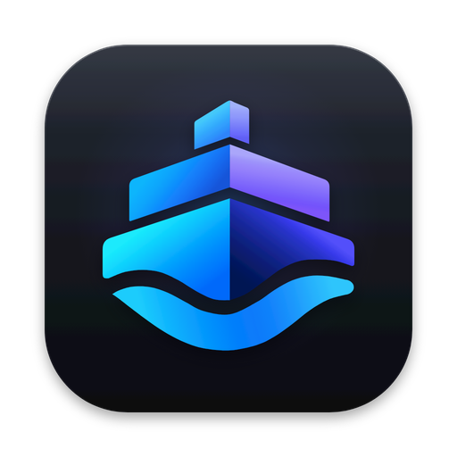
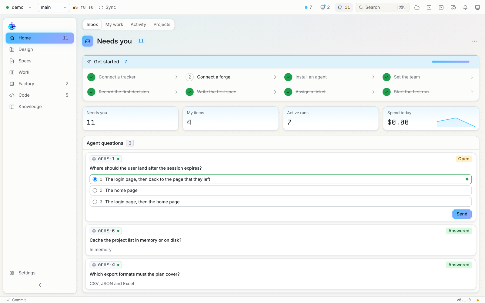
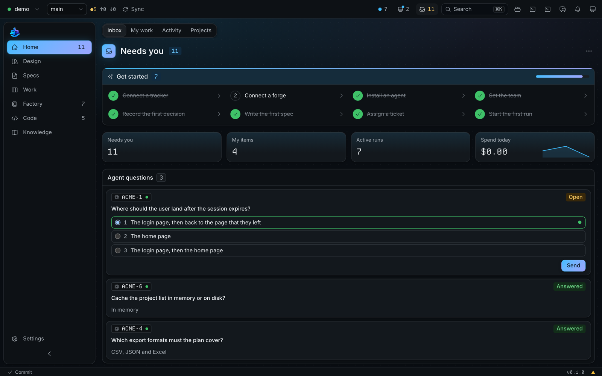
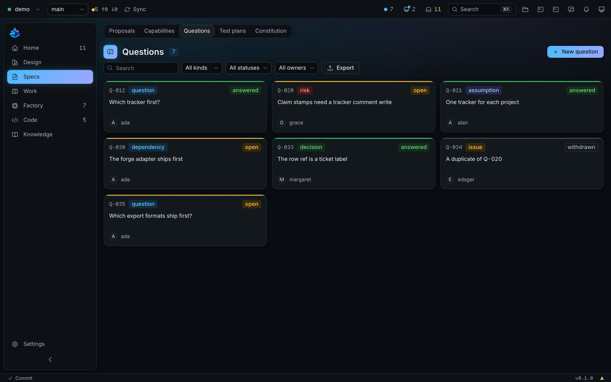
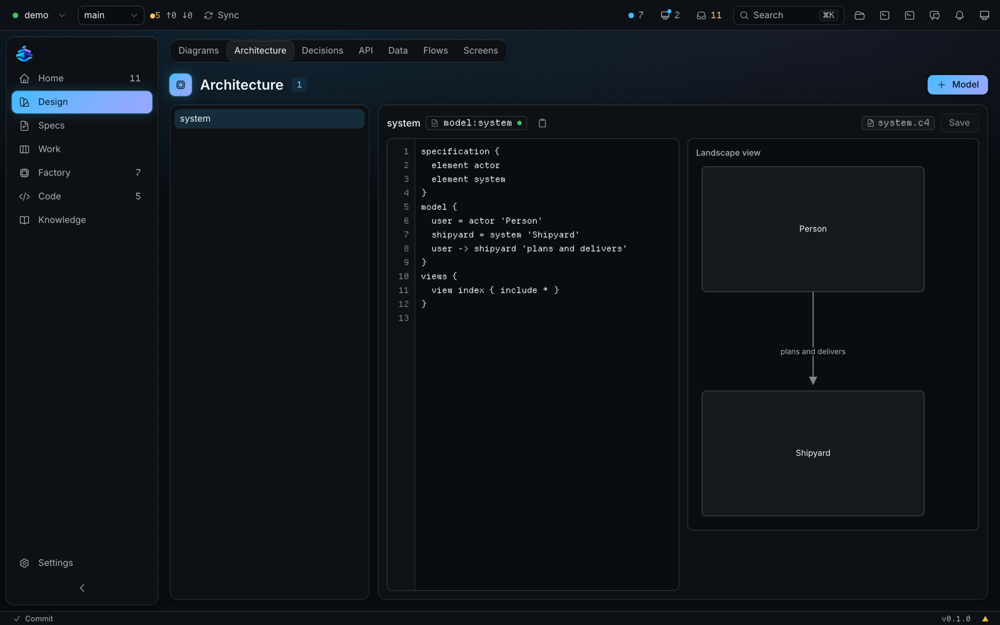
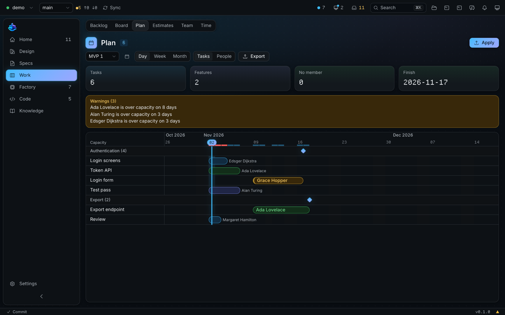
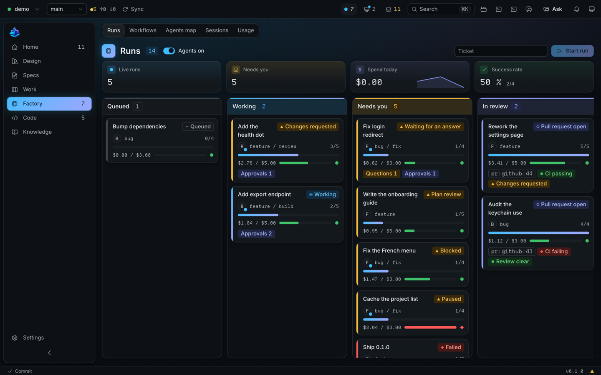
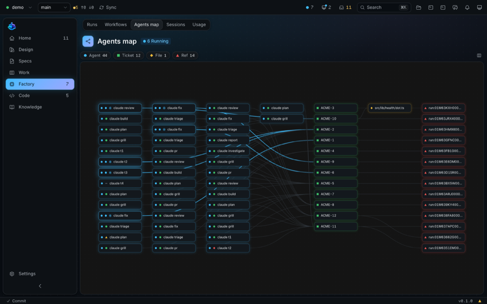
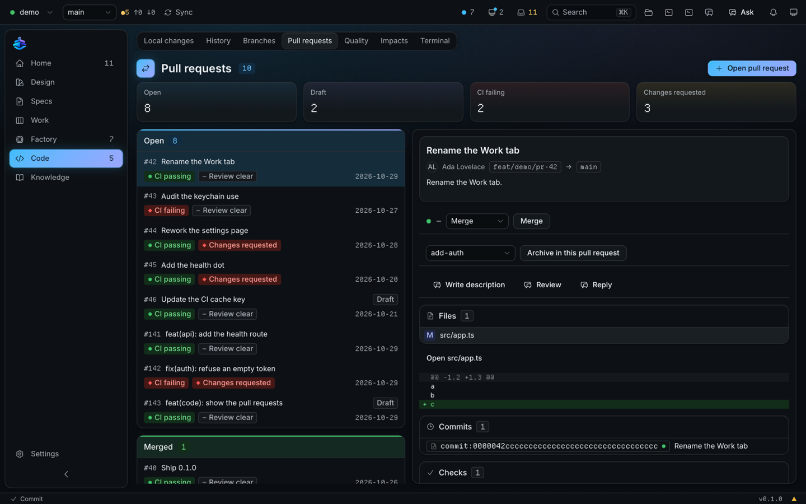
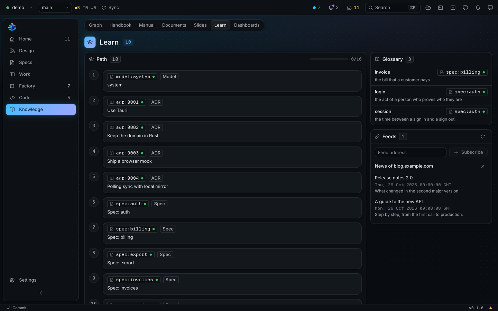

<div align="center">
<br />

<h1>Shipyard</h1>
<p><strong>One desktop app to design, specify, plan and ship a project with a team of people and agents.</strong></p>
<p>
<a href="https://github.com/me-cedric/Shipyard/actions/workflows/ci.yml"></a>
<a href="https://github.com/me-cedric/Shipyard/releases/latest"></a>
<a href="LICENSE"></a>
<a href="https://ko-fi.com/mecedric"></a>
</p>
<p>
<a href="https://www.rust-lang.org"></a>
<a href="https://react.dev"></a>
<a href="https://www.typescriptlang.org"></a>
<a href="https://tauri.app"></a>


</p>
<p>
<a href="#features">Features</a> ·
<a href="#build-from-source">Install</a> ·
<a href="#how-it-works">How it works</a> ·
<a href="#documentation-map">Docs</a> ·
<a href="#contributing">Contributing</a>
</p>
<br />
</div>

<p align="center">
  
</p>

Shipyard is for every role on a project: project manager, architect, developer, tester, business analyst, functional lead and junior. It needs little technical knowledge. It guides each step, picks safe defaults and uses plain words.

The whole team works in one loop: **spec, plan, work items, runs, pull request, review.** Agents and people share this loop. An agent asks a question when a person must decide. A person approves each write to an issue tracker or a code host, or turns on a durable permission.

Everything that the team writes lives in the Git repository of the project. Shipyard is a window on that repository.

## Status

Shipyard is pre-release software, version 0.1.0. No packaged release exists yet: you build it from source. Unit, Rust and browser end-to-end tests cover every space. The end-to-end run on a real project with a live code host is in progress (wave W13).

| Area | Current state |
| --- | --- |
| Shell | Works. Seven spaces and Settings, command palette, inspector, assistant panel, notification centre, status bar with one Commit action and one Sync action. |
| Projects | Works. Open a folder, clone, or create a project. A project profile hides or locks pages. |
| Design | Works. Diagrams (Excalidraw, Mermaid, BPMN, draw.io), LikeC4 architecture, decisions, API, data, flows and screens. |
| Specs | Works. OpenSpec changes with validation, capabilities, questions, test plans in Gherkin. |
| Work | Works. Backlog and board from a local mirror of the issue tracker, Gantt plan, estimates, team and time. |
| Factory | Works. Runs in lanes, workflows as YAML, agents map, sessions, usage and budgets. Automation writes are off by default. |
| Code | Works. Changes, history, branches, pull requests with agent reviews, quality, impacts and a terminal. |
| Knowledge | Works. Reference graph, handbook, in-app manual, documents, slides, learning paths and dashboards. |
| Issue trackers and code hosts | Jira Cloud and Data Center, GitHub Issues, GitLab Issues, Azure DevOps and Linear. Pull requests on GitHub and GitLab. Azure DevOps is a code host adapter. Each adapter has fake-based contract tests. Not every adapter has run against a live account. |
| Agents | Claude Code, Codex, Gemini CLI, OpenCode, GitHub Copilot (ACP) and HTTP model providers. |
| MCP | Works. Shipyard serves its own MCP server and runs the MCP servers of the project. A GitLab sign-in adds the GitLab MCP server with one switch. |
| Packaging | In progress. The release build bundles the `shipyard` command as a sidecar. No signed installer and no release workflow yet. |
| Automation | Works. Pickup, claims, budgets and automatic agent reviews run. Write switches (push, pull request, issue tracker transition, issue tracker comment) are off by default, on purpose: an admin turns them on. |

See [CHANGELOG.md](CHANGELOG.md) for the latest changes and [docs/plan/MASTER-PLAN.md](docs/plan/MASTER-PLAN.md) for the plan.

## Features

<p align="center">
  
  &nbsp;
  
</p>

<p align="center">
  
  &nbsp;
  
</p>

<p align="center">
  
  &nbsp;
  
</p>

<p align="center">
  
  &nbsp;
  
</p>

### Home

- Inbox "Needs you": agent questions with numbered options, approvals that name the exact write, plans to approve, messages.
- My work, Activity and Get started steps for a new project.
- Key figures and dashboard tiles.

### Design

- Diagrams: edit Excalidraw, Mermaid and BPMN. Edit draw.io online. Convert a board between formats.
- Architecture: LikeC4 models with a live render.
- Decisions: write an ADR in a form, then accept or reject it with a comment.
- API (OpenAPI), Data (DBML), Flows (network flows with bricks) and Screens (HTML mockups, images, Figma files and design tokens).

### Specs

- Proposals: each OpenSpec change shows the state of its proposal, spec, plan, checklist and tasks. Strict validation shows each finding on its line.
- Capabilities with their requirements and backlinks.
- Questions register (RAID) with filters. An answer folds into its spec.
- A change from an issue tracker item, on its own specs branch, handed to an agent in one click.
- Test plans in Gherkin, with scenario lint, coverage and the last verdict.
- Split a change into epics and stories, then apply them to the issue tracker. A second apply creates no duplicate.

### Work

- Backlog and Board from a local mirror of the issue tracker. A sync tick keeps it current.
- Plan: a Gantt with capacity, holidays, day, week and month zoom, and a PNG export.
- Estimates: three-point estimates, price, cost and margin. Seal sheets with a passphrase. Import and export Excel.
- Team and Time: members, skills, capacity, absences, time entries and the whole month of worklogs in one click.
- Cost privacy: no cost shows for a role with fewer than three rated members.

### Factory

- Runs in lanes: Queued, Working, Needs you, In review, Ready to merge, Done.
- Workflows as YAML files with roles, gates, fan-out, budgets and retries.
- Agents map, Sessions with a kill switch, and Usage with spend per run, day, member and iteration.

### Code

- Local changes, history, branches, conflicts, stash and one Commit action.
- Pull requests on GitHub and GitLab: files, commits, checks, verdicts, review and merge after a click.
- Review with an agent (a draft with findings on the diff), Write with an agent for a new pull request, and an automatic review setting. The agent follows the project's review and pull request rules.
- Quality (scanner reports, security score, CycloneDX SBOM), Impacts on seven axes, a terminal and open in your code editor.

### Knowledge

- Graph of the refs of the project and of its code.
- Handbook, Manual (the user guide, searchable, inside the app), Documents (Markdown, export to `.docx` and `.xlsx`), Slides (reveal.js).
- Learn: learning paths, glossary and news feeds. Dashboards with tiles.

### Assistant

- A panel in every space (`Mod+J`) with threads per project, and Ask, Plan and Agent modes.
- Agent mode works in a worktree of its own. It asks for a click before it edits.
- An Ask menu on each page with prompts for the item that you select.
- Tabs with unread marks, a live trace of each turn, Quote and Redo.

### Integrations

- Issue trackers: Jira Cloud, Jira Data Center, GitHub Issues, GitLab Issues, Azure DevOps, Linear.
- Code hosts: GitHub, GitLab, Azure DevOps. Sign in with the browser for GitHub and GitLab.
- Agent runners: Claude Code, Codex, Gemini CLI, OpenCode, GitHub Copilot (ACP), HTTP model providers.
- MCP servers: a catalogue, custom servers, start, stop, test, and relay to agents.
- English and French interface. Accent colour, sides, date format, window size and a portable mode.

## How it works

A Shipyard project is a Git repository. Text files hold the artifacts. The issue tracker holds the tickets. The code host holds the pull requests. Machine state (a mirror, run logs, caches) stays in the app data folder and never enters the repository.

```
my-project/
├── .shipyard/
│   ├── project.yaml          # name, key, connection ids (no secret)
│   ├── team.yaml             # members, roles, capacity
│   ├── automation.yaml       # pickup filter, concurrency, write switches
│   ├── workflows/            # one YAML file per workflow
│   └── roles/                # one Markdown profile per agent role
├── docs/
│   ├── openspec/             # changes, specs, constitution
│   ├── decisions/            # ADRs
│   ├── delivery/questions/   # one RAID file per question
│   ├── diagrams/             # Excalidraw, Mermaid, BPMN, draw.io, LikeC4
│   ├── handbook/             # Markdown pages
│   ├── costing/              # estimate sheets
│   └── planning/             # plan decisions (never a computed date)
└── AGENTS.md                 # the agent contract
```

Each item has a stable ref, such as `adr:0004`, `spec:auth/login` or `wi:SHIP-42`. Each view shows the backlinks of its item. The knowledge graph draws these links.

The loop:

1. **Spec.** A change starts as a proposal. Questions that need a person go to the register.
2. **Plan.** The change gets a plan, a checklist and tasks.
3. **Work items.** The tasks become epics and stories in the issue tracker.
4. **Runs.** A run takes a ticket, follows a workflow and works in its own worktree.
5. **Pull request.** The run opens a pull request. The body lists the impacts.
6. **Review.** A reviewer agent reads it in a fresh context. A person merges.

A run asks a question when a person must decide. It moves to "Waiting for an answer" and resumes with the answer.

## Architecture

Shipyard is a [Tauri 2](https://tauri.app) app. A Rust workspace holds the logic. A React app holds the interface.

| Crate | Content |
| --- | --- |
| `shipyard-core` | Domain types, refs, run state machine, workflow model. No I/O. |
| `shipyard-store` | SQLite mirror and run log. Codecs for the files of the repository (YAML, MADR, RAID, OpenSpec). |
| `shipyard-trackers` | The `Tracker` trait and the adapters (Jira, GitHub, GitLab, Azure DevOps, Linear). |
| `shipyard-forges` | The `Forge` trait, pull requests and CI status. |
| `shipyard-git` | Git operations and worktrees. Git credentials live here only. |
| `shipyard-agents` | Agent runners (CLI and HTTP), MCP injection and session resume. |
| `shipyard-engine` | Scheduler tick, claims, dispatch, budgets and retries. |
| `shipyard-mcp` | MCP server (stdio, HTTP, relay), gates and proxy. |
| `shipyard-http` | HTTP client shared by the adapters. |
| `shipyard-secrets` | Secret storage in the OS keychain. |
| `shipyard-app` | The Tauri shell. Commands are grouped by feature. |
| `shipyard-cli` | The `shipyard` binary: the MCP relay for agents. |

Frontend layout:

| Path | Content |
| --- | --- |
| `src/features/<space>/` | One folder per space: home, specs, design, code, work, factory, knowledge, settings, assistant. A feature imports only `@/ui`, `@/lib` and its own folder. |
| `src/ui/` | The design system in atomic layers: tokens, icons, atoms, molecules, organisms, templates. |
| `src/lib/ipc/` | Generated bindings and the mock layer. |
| `src/lib/i18n/` | English and French catalogues. |
| `e2e/` | Playwright tests. |

Typed IPC: `tauri-specta` generates the TypeScript types and command functions from the Rust commands. Nobody edits `src/lib/ipc/bindings.ts` by hand. CI fails when it is stale.

Browser mock: outside Tauri, a mock layer serves the same contract. The interface then runs in a browser with no Rust. Vite, Vitest and Playwright use it.

Stack: React 19, Vite 8, TypeScript, Tailwind 4, Base UI, TanStack (Router, Query, Table, Virtual), xyflow, Rust edition 2024, Tauri 2, SQLite.

## Decisions

The [`docs/decisions/`](docs/decisions/) folder holds 15 ADRs. Start with these:

| ADR | Decision |
| --- | --- |
| [0001](docs/decisions/0001-shipyard-product-scope.md) | Product scope |
| [0002](docs/decisions/0002-stack-tauri-rust-workspace-react.md) | Tauri, a Rust workspace and React |
| [0003](docs/decisions/0003-ipc-generated-with-tauri-specta.md) | IPC generated with tauri-specta |
| [0004](docs/decisions/0004-seven-spaces-information-architecture.md) | Seven spaces |
| [0005](docs/decisions/0005-run-state-owned-by-shipyard.md) | Shipyard owns the run state |
| [0006](docs/decisions/0006-workflows-as-yaml-dag.md) | Workflows as a YAML graph |
| [0007](docs/decisions/0007-polling-sync-with-local-mirror.md) | Polling sync with a local mirror |
| [0008](docs/decisions/0008-questions-as-ticket-comments.md) | Questions as ticket comments |

## Install

No release exists yet. [Build from source](#build-from-source).

## Build from source

Prerequisites:

| Tool | Version |
| --- | --- |
| Git | Any recent version. Clone with submodules. |
| Rust | Stable, 1.85 or later (edition 2024). Install with [rustup](https://rustup.rs). |
| Node | 24 or later. |
| pnpm | 11. Run `corepack enable`. |

Platform notes for Tauri:

| Platform | Needs |
| --- | --- |
| macOS | Xcode Command Line Tools: `xcode-select --install`. |
| Windows | Microsoft C++ Build Tools and WebView2. See the [Tauri prerequisites](https://tauri.app/start/prerequisites/). |
| Linux | `libwebkit2gtk-4.1-dev`, `libayatana-appindicator3-dev`, `librsvg2-dev`, `patchelf` (Debian and Ubuntu names). |

Clone and run:

```bash
git clone --recurse-submodules https://github.com/me-cedric/Shipyard.git
cd Shipyard
node docs/agent-compass/bin/ac.mjs doctor   # checks the agent contract
pnpm install
pnpm tauri dev                              # desktop app
```

To try the interface in a browser with demo data and no Rust:

```bash
pnpm dev                                    # http://localhost:1420
```

Build a release bundle with the `shipyard` sidecar:

```bash
pnpm tauri:release
```

## Development

| Command | What it does |
| --- | --- |
| `pnpm dev` | Interface in a browser, with the mock IPC, on port 1420. |
| `pnpm tauri dev` | Desktop app. |
| `pnpm build` | Production build of the interface. |
| `pnpm preview` | Serve the production build. |
| `pnpm lint` | Biome check. |
| `pnpm format` | Biome format. |
| `pnpm typecheck` | TypeScript, strict. |
| `pnpm test` | Unit tests (Vitest). |
| `pnpm test:e2e` | End-to-end tests (Playwright). |
| `pnpm ipc:gen` | Run the Rust tests. They write `src/lib/ipc/bindings.ts`. |
| `pnpm ipc:check` | Fail when the committed bindings differ from the Rust commands. |
| `pnpm tauri:release` | Release bundle, with the `shipyard` sidecar. |
| `cargo test --workspace` | Rust tests. |

The [developer guide](docs/guide/dev.md) explains how to add a command, the app data folder, the project import and the sidecar.

## Testing

- **Unit.** Vitest and Testing Library test the interface. Run `pnpm test`.
- **Rust.** Domain logic has unit tests. Adapters have contract tests with fakes. Run `cargo test --workspace`.
- **End to end.** Playwright runs on the release build with the mock IPC. One file covers each space. Run `pnpm test:e2e`.
- **Accessibility.** `e2e/a11y.spec.ts` runs axe on every tab of every space, in the light and the dark theme, with reduced motion. A violation fails the test.

CI runs all checks on macOS and Linux: lint, typecheck, unit, build, end-to-end, `cargo fmt`, `cargo clippy`, `cargo test` and `pnpm ipc:check`.

## Contributing

- **Specs first.** Each feature starts as an OpenSpec change in `docs/openspec/changes/<id>/`. The schema is `shipyard-delivery`.
- **Decisions.** An architecture decision gets an ADR in `docs/decisions/`.
- **Waves.** The build follows the waves in [`docs/plan/MASTER-PLAN.md`](docs/plan/MASTER-PLAN.md). One session works on one wave.
- **Rules.** Read [`docs/openspec/constitution.md`](docs/openspec/constitution.md) and [`AGENTS.md`](AGENTS.md) before a change. Agents and people follow the same rules.
- **Generated files.** Never edit the IPC bindings or the mocks that a tool generates.
- **Interface.** No taglines, no helper text, no secondary labels. Change the layout instead. English and French ship together.
- **Changelog.** Each user-visible change adds one entry to [`CHANGELOG.md`](CHANGELOG.md) and [`CHANGELOG.fr.md`](CHANGELOG.fr.md), with the same number of bullets.

## Documentation map

| Document | Content |
| --- | --- |
| [`docs/guide/start.md`](docs/guide/start.md) | Getting started: the window, a project, your role, words. |
| [`docs/guide/home.md`](docs/guide/home.md) | Home. |
| [`docs/guide/design.md`](docs/guide/design.md) | Design. |
| [`docs/guide/specs.md`](docs/guide/specs.md) | Specs. |
| [`docs/guide/work.md`](docs/guide/work.md) | Work. |
| [`docs/guide/factory.md`](docs/guide/factory.md) | Factory. |
| [`docs/guide/code.md`](docs/guide/code.md) | Code. |
| [`docs/guide/knowledge.md`](docs/guide/knowledge.md) | Knowledge. |
| [`docs/guide/settings.md`](docs/guide/settings.md) | Settings. |
| [`docs/guide/dev.md`](docs/guide/dev.md) | Developer guide. |
| [`docs/plan/MASTER-PLAN.md`](docs/plan/MASTER-PLAN.md) | Goal, concept model, factory loop, architecture. |
| [`docs/openspec/constitution.md`](docs/openspec/constitution.md) | The rules for every spec, plan and task. |
| [`docs/openspec/changes/`](docs/openspec/changes/) | Changes in progress. |
| [`docs/decisions/`](docs/decisions/) | Architecture decision records. |
| [`docs/design/visual-language-v2.md`](docs/design/visual-language-v2.md) | The visual language. |
| [`docs/delivery/questions/`](docs/delivery/questions/) | Open questions. |
| [`CHANGELOG.md`](CHANGELOG.md), [`CHANGELOG.fr.md`](CHANGELOG.fr.md) | Release history in English and French. |
| [`AGENTS.md`](AGENTS.md) | Rules for agents. |

The same guide is in the app: open Knowledge, then Manual.

## Security

- Secrets live in the OS keychain. A secret never goes in an argument, a URL, a log or a file of the repository. The app never shows a saved token again.
- Writes to an issue tracker, a code host or a remote need a click or a durable permission that an admin sets. All write switches are off by default.
- A project profile can set a page to read-only. A read-only project takes no change.
- Each run has a budget, a stall timeout and a kill switch. A global switch stops all agents.
- The app has a content security policy: only its own files, the Tauri IPC and the draw.io editor frame (`embed.diagrams.net`).
- The interface renders HTML mockups in a sandboxed frame.
- Local data stays on your machine. Shipyard has no backend of its own.

To report a vulnerability, open a [private security advisory](https://github.com/me-cedric/Shipyard/security/advisories/new). For other problems, open a [GitHub issue](https://github.com/me-cedric/Shipyard/issues). Do not put a secret in it.

## License

Shipyard is released under the [MIT License](LICENSE).

## Acknowledgements

Shipyard builds on these projects:

- [Tauri](https://tauri.app), [React](https://react.dev), [Vite](https://vite.dev), [Tailwind CSS](https://tailwindcss.com), [Base UI](https://base-ui.com) and [TanStack](https://tanstack.com).
- [OpenSpec](https://github.com/Fission-AI/OpenSpec) for the spec format.
- [agent-compass](https://github.com/me-cedric/agent-compass) for the agent contract.
- [draw.io](https://www.drawio.com) (online embed), [Excalidraw](https://excalidraw.com), [bpmn-js](https://bpmn.io), [Mermaid](https://mermaid.js.org) and [LikeC4](https://likec4.dev) for diagrams.
- [xyflow](https://xyflow.com) for graphs, [reveal.js](https://revealjs.com) for slides and [xterm.js](https://xtermjs.org) for the terminal.
- [Inter](https://rsms.me/inter/) for the fallback font.
